<div align="center">

# Agentic Warehouse Analyst

### A multi-agent analyst that answers business questions over a **billion-row warehouse on one laptop**, and says "I don't know" when it should.


[Results](#results) · [Architecture](#architecture) · [Quick start](#quick-start) · [The build, step by step](#the-build-step-by-step) · [Evaluation](#how-it-is-evaluated) · [Limits](#known-limits)

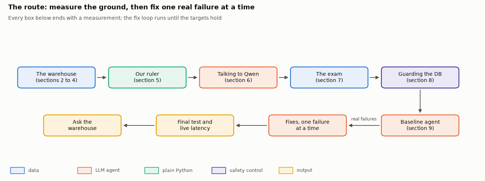

</div>

---

## Why this exists

A text-to-SQL agent is easy to demo and hard to trust. The query runs, a number comes back, and nobody notices that it summed the wrong column, dropped every row with a missing key, or answered a question the data cannot answer.

This project builds the whole thing the way a production team would, on real data, and **measures every decision**:

| The problem | What this repository does about it |
|---|---|
| **Confident wrong numbers.** A directly prompted model answers everything, and almost half its answers are wrong. | Two independent routes must agree, a critic settles disagreements, and the system declines when it cannot answer. |
| **Safety.** A plain `SELECT` can read files, list folders and attach databases. | A statement guard with its own cost estimator, plus a locked read-only connection. 0 of 11 attacks succeed. |
| **Scale.** A billion rows do not fit a naive pipeline. | Date-sorted storage, rollup tables, timeouts and a cap on every query. Warehouse time fell from 6.9 s to 0.9 s (median). |
| **Latency and cost.** Models are slow and billed per call. | Speculative parallel calls, a replayable cache, and the model for each role chosen by measurement. |
| **Trust in the measurements.** Bad evaluation flatters bad agents. | A held-out test set, official TPC-DS answers as ground truth, bootstrap intervals, and a live stopwatch run. |

Everything runs on the **real TPC-DS scale-factor-100 warehouse**: 24 tables, **959,031,513 rows**, about 103 GB as raw text, stored as one 28.6 GB DuckDB file. No sampling, no mock data.

---

## Results

Measured on **194 held-out test questions** the system was never tuned on, answered one at a time (one user), on a laptop with 16 cores, 31 GiB of memory and no GPU.

| | Obvious agent | **This system** | Target |
|---|:---:|:---:|:---:|
| Everyday questions correct (T1) | 66.7% | **90.9%** (95% CI 85% to 96%) | at least 90% |
| Analyst questions correct (T2) | 39.0% | **80.5%** | |
| Official TPC-DS questions correct (T3) | 37.5% | **62.5%** | |
| Should-not-answer handled (T4) | 23.3% | **100%** | |
| False-success (answered but wrong) | 47.1% | **9.8%** | at most 5% |
| Latency p50, one user | 3.3 s | **3.4 s** | at most 5 s |
| Latency p95, one user | 17.1 s | **12.8 s** | at most 15 s |
| Cost per question (Magicubes) | 0.20 | 0.62 | |

> **The honest summary.** Everyday accuracy and both latency targets are met on the test set. False-success is cut from 47.1% to 9.8% but **misses the 5% target**, and in a separate live stopwatch run with the cache off the p95 was 24.6 s (p50 3.8 s) because a few heavy queries dominate the tail. Both gaps are measured and explained in the notebook, including the options that would close them and what each costs.

<div align="center">
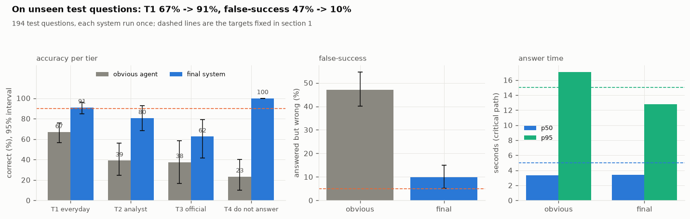
</div>

Held-out question *shapes* are harder: everyday accuracy is 96.1% on templates seen during development and 85.4% on the twelve templates held out entirely. The notebook reports both.

---

## Architecture

One question flows through a small team of agents. Every agent is a plain Python function, and each one is in the system because a measured experiment said it earns its place.

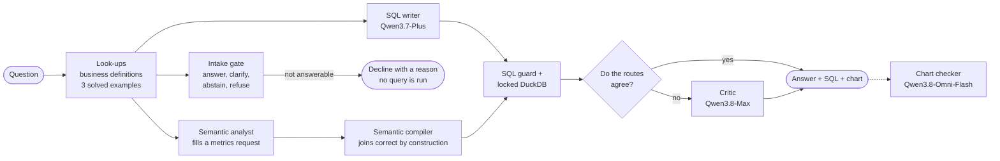

The gate and both analysts start **at the same moment**. Nothing touches the warehouse until the gate says "answer", so a refused question never runs a query.

<div align="center">
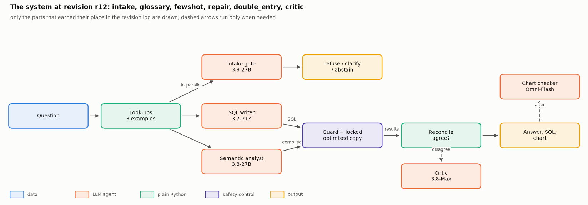
</div>

### What happens to one question

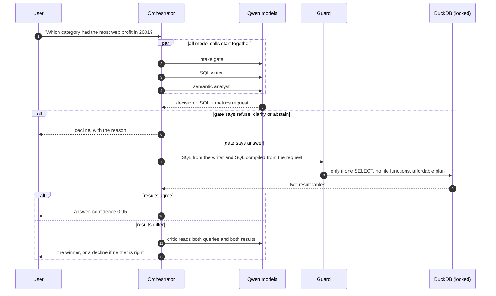

### Defence in depth

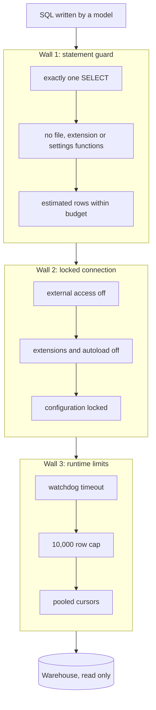

The planner's own row estimate underestimated a fan-out join by a factor of **469,796** (true size 135,299,781,560,539 rows), so the guard uses its own estimator, calibrated on the 99 official queries. Across the 11 attacks in the notebook, five work on an open read-only connection, and none survive both walls.

<div align="center">
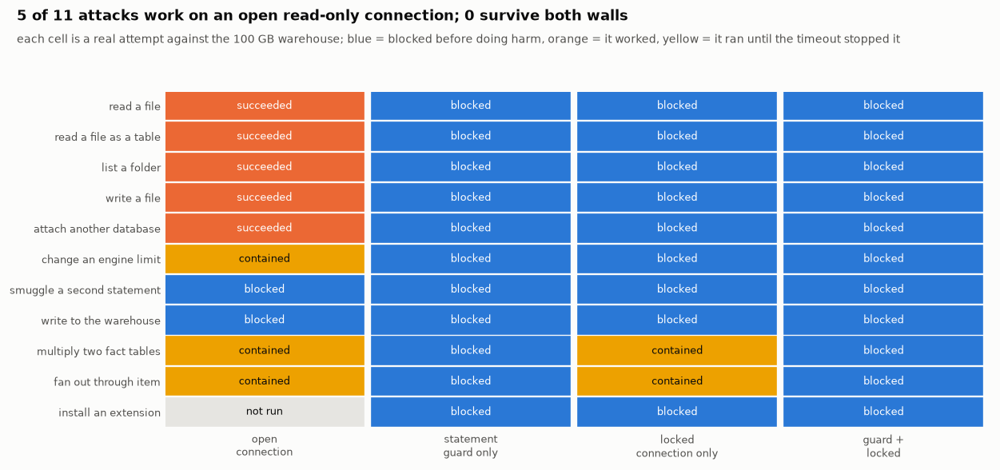
</div>

---

## The build, step by step

The notebook starts with the obvious agent, watches where it fails on real questions, and fixes **one thing at a time**. Each change is kept only if it raises *utility* (+1 for a right answer, 0 for declining, -2 for a confident wrong answer) without slowing the 95th percentile by more than 10%.

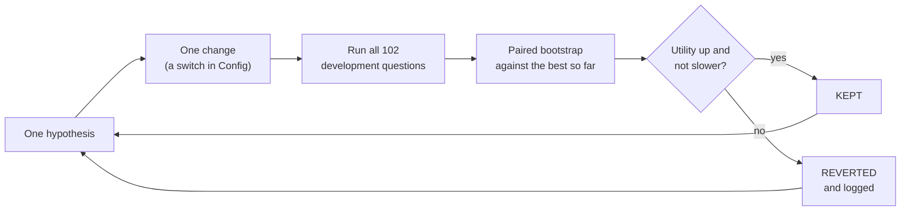

| Rev | Change | Decision | Utility | T1 | False-success | p50 |
|---|---|:---:|---:|---:|---:|---:|
| r00 | Baseline: whole schema, one call | start | -0.333 | 64.7% | 47.3% | 6.36 s |
| r01 | Intake gate (answer, clarify, abstain, refuse) | kept | +0.118 | 62.7% | 36.8% | 7.75 s |
| r02 | Business definitions and measured facts | kept | +0.382 | 80.4% | 25.0% | 6.95 s |
| r03 | Look question words up in the data | reverted | +0.284 | 78.4% | 29.5% | 5.45 s |
| r04 | Show only the tables a search picks | reverted | +0.206 | 62.7% | 32.8% | 5.43 s |
| r05 | Database-guided repair, empty is never an answer | kept | +0.412 | 84.3% | 24.1% | 7.53 s |
| r06 | Three similar solved examples | kept | +0.696 | 94.1% | 11.5% | 7.04 s |
| r07 | Double entry with a critic | kept | +0.706 | 94.1% | 10.5% | 12.27 s |
| r09 | Date-sorted copy and rollup tables | kept | +0.716 | 98.0% | 11.3% | 6.03 s |
| r10 | Intake runs beside the analysts | kept | +0.716 | 98.0% | 11.3% | 5.07 s |
| r12 | SQL writer moves to Qwen3.7-Plus | kept | +0.833 | 98.0% | 6.2% | 3.68 s |
| r13 | A second SQL writer | reverted | +0.804 | 98.0% | 7.5% | 4.13 s |
| r15 | 15 second budget per question | reverted | +0.804 | 98.0% | 7.5% | 4.25 s |

All figures are on the development questions, answered four at a time. Two thirds of the work is finding out what **not** to build: value grounding, the schema scout, a second writer and a time budget were each built, measured and dropped.

<div align="center">
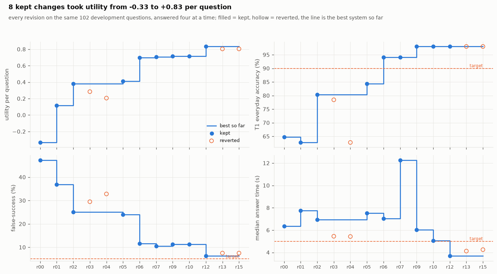
</div>

### Making the warehouse side fast

Sorting the fact tables by date lets DuckDB skip blocks using its min/max statistics. Rollup tables pre-aggregate the additive measures, and the compiler routes to them only when the answer cannot change. All 37 real requests a rollup could serve returned identical answers.

<div align="center">
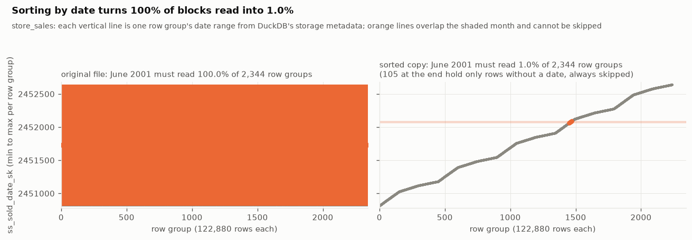
</div>

A one-month filter on store sales must read **100%** of the blocks in the original file and **1.0%** in the sorted copy. Across the development questions, warehouse time per question fell from 6.88 s to 0.92 s at the median.

<div align="center">
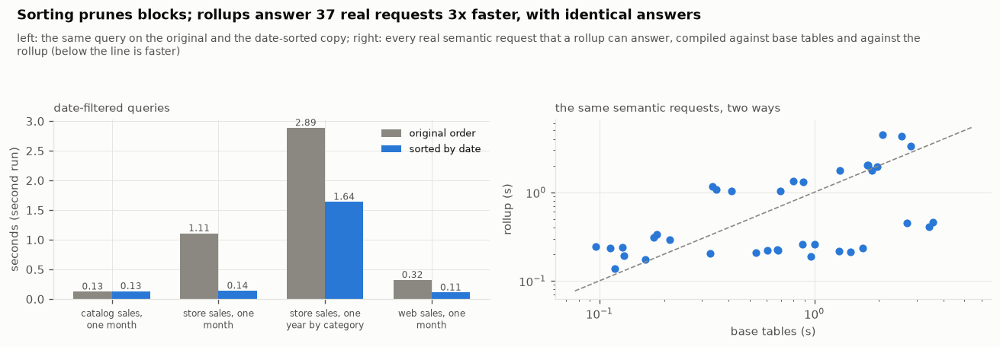
</div>

---

## How it is evaluated

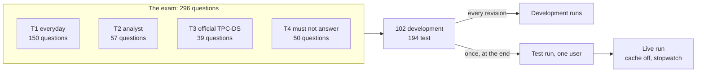

- **Trusted ground truth.** Every answer key is computed from the warehouse by hand-written reference SQL, or taken from the official TPC-DS answer files. The comparator reproduces **92 of 93** official answers (the 93rd hit the 15 minute limit).
- **Real parameters.** States, categories and years in the questions are drawn from the data itself.
- **Held-out shapes.** About 30% of templates appear only in the test set, so part of the test asks question shapes the system never met.
- **Honest statistics.** Bootstrap confidence intervals, paired bootstrap between revisions, a risk-coverage curve, and a failure taxonomy of 11 kinds for every revision.
- **Latency measured two ways.** A critical-path estimate (the slowest call in each parallel step) for comparing revisions, and a live uncached stopwatch run for the headline number.
- **Bugs in the evaluation are part of the record.** The notebook ends with a registry of real defects found while building it, each with its measured effect.

---

## Quick start

> Developed and tested on **Windows 11**. `tools/run_nb.py` uses the Windows virtual environment layout; on Linux or macOS use the same commands with `.venv/bin/python`.

### Prerequisites

| Need | Why |
|---|---|
| Python 3.12 and [uv](https://docs.astral.sh/uv/) | environment |
| About 70 GB free disk | 28.6 GB warehouse, plus a 33.3 GB sorted copy that the notebook builds |
| 32 GB of memory recommended | DuckDB caches what it reads; the build was tested with other applications open |
| A ModelScope API key | only needed for model calls that are not already cached |

### 1. Environment

```bash
uv venv .venv --python 3.12
uv pip install --python .venv/Scripts/python.exe -r requirements.txt
.venv/Scripts/python.exe -m ipykernel install --prefix .venv --name tpcds-agent --display-name "Python (tpcds-agent)"
```

### 2. API key

Create `modelscope.txt` in the repository root containing only your key. It is listed in `.gitignore` and is read once by the client, never printed. The five allowed models and their prices are in [`ALLOWED_MODELS.md`](ALLOWED_MODELS.md).

### 3. Data

```bash
.venv/Scripts/python.exe tools/fetch_data.py
```

Downloads the prebuilt TPC-DS scale-100 file (28,609,622,016 bytes) to `D:/tpcds_agent`, resumes if interrupted and checks the exact size. To use another folder, edit `DATA` in `tools/fetch_data.py` and set `DATA_DIR` in the notebook's parameter cell.

### 4. Run

```bash
# quick check of every code path on a small generated copy (scale 1), a few minutes
.venv/Scripts/python.exe tools/run_nb.py --smoke

# the real run on the 100 GB warehouse
.venv/Scripts/python.exe tools/run_nb.py --name sf100_final
```

The executed notebook is written to `notebook/runs/`. Open it in JupyterLab, or read the version that is already committed at [`notebook/agentic_data_analyst.executed.ipynb`](notebook/agentic_data_analyst.executed.ipynb).

### Reproducing the results for free

The repository includes the model-call cache (`notebook/artifacts/llm_cache.sqlite`, 4,005 recorded calls) and every saved evaluation run. A re-run replays them, so it **costs no API credit**, and a replayed call reports the latency recorded when it was first made, never the microseconds a cache read takes. The only expensive step is the one-time 3 hour build of the date-sorted copy, which the notebook skips if the file already exists.

---

## Repository layout

```text
agentic-warehouse-analyst/
├── notebook/
│   ├── agentic_data_analyst.py          the whole course, as one jupytext notebook (sections 0 to 30)
│   ├── agentic_data_analyst.executed.ipynb   the run behind every number in this README
│   └── artifacts/
│       ├── figures_sf100/               34 figures and diagrams
│       ├── results_sf100/               saved evaluation runs, timings, attack matrix
│       ├── official_answers/sf100/      official TPC-DS answers (93 of 99 queries)
│       ├── llm_cache.sqlite             recorded model calls, for free replay
│       ├── revisions_sf100.csv          the revision log
│       └── run_manifest_sf100.json      versions, settings, models, final system
├── tools/
│   ├── fetch_data.py                    resumable, size-checked download
│   ├── run_nb.py                        build and execute the notebook headless
│   ├── show_outputs.py                  read a run's outputs in a terminal
│   └── lint_notebook.py                 style and number-backing checks
├── ALLOWED_MODELS.md                    models and prices
├── requirements.in / requirements.txt   direct and frozen dependencies
└── LICENSE
```

### The notebook, section by section

| Part | Sections |
|---|---|
| **The ground** | 0 Setup · 1 The problem · 2 Getting 100 GB onto a laptop · 3 Meeting the data · 4 Can a laptop query a billion rows? |
| **The instruments** | 5 Proving the ruler · 6 Talking to the models · 7 The exam · 8 Guarding the database |
| **The build** | 9 The obvious agent · 10 The revision loop · 11 Intake · 12 Definitions · 13 Value grounding · 14 Schema scout · 15 Repair · 16 Solved examples · 17 Double entry · 18 Risk and coverage · 19 Charts |
| **Speed** | 20 The warehouse side · 21 The model side |
| **Depth and choice** | 22 Deep mode · 23 Which model for which job · 24 Second pass |
| **The proof** | 25 The revision journey · 26 The test · 27 Live latency · 28 Ask the warehouse |
| **Honesty** | 29 What is claimed and what is not · 30 Reproducing this |

Section 28 is an interactive "Ask the warehouse" widget: type a question and get the answer, the SQL, the confidence, the cost, a chart with the checker's verdict, and a timeline of where the time went.

---

## Models

| Role | Model | Price per call |
|---|---|---:|
| SQL writer | Qwen3.7-Plus | 0.2 |
| Intake gate, semantic analyst | Qwen3.8-27B | 0.2 |
| Critic, investigator (deep mode) | Qwen3.8-Max | 0.5 |
| Chart checker (vision) | Qwen3.8-Omni-Flash | not published |

Billing is per call, not per token. The whole build, every experiment included, cost about 1,026 Magicubes counting cached answers. The writer was chosen by running the system five times with only the writer's model changed.

---

## Known limits

- **One warehouse, one schema.** The definitions, the semantic catalogue and the rollups were built for TPC-DS. Moving to another warehouse means rebuilding them.
- **Benchmark data.** TPC-DS is generated retail data, not a real company's records, and part of the question set is written for this project and labelled as such.
- **One user at a time.** Latency is measured for a single user. Many simultaneous users would be limited by the model API's concurrency cap, which this project does not measure.
- **Two targets missed.** False-success (9.8% against 5%) and live p95 latency (24.6 s against 15 s). A 15 second per-question budget brings live p95 to 10.0 s but costs a right answer on the development set, so it ships switched off.
- **The test set was used more than once.** Reading development results after the first test run exposed two wrong decision rules. They were fixed on development data, the pipeline finished, and the test was run again. Every earlier test run is printed in the notebook.
- **Prompt injection hidden inside data cells** was not tested, and the chart checker's price was unpublished, so its cost is left out of the totals.

---

## License

[MIT](LICENSE). The TPC-DS benchmark data and queries are the property of the TPC and are used here as a public benchmark.
